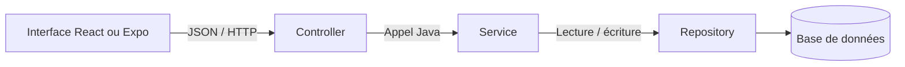

# TP 5 — Tests unitaires et documentation de FleetPulse

## 1. Périmètre de ce travail

Date de vérification : 17 novembre 2026.

Le périmètre retenu est celui des **sprints 1 à 3**, hors développement de
l’authentification. Les écrans React et Expo sont conservés tels quels.
Les modules finance, BI, litiges et IA prévus dans les sprints suivants ne font
pas partie de cette livraison.

Le projet est **full-stack** : Spring Boot expose une API REST ; React et Expo
consomment cette API. La consigne concernant Swagger s’applique donc au projet.
Thymeleaf n’est pas nécessaire pour cette architecture.

Le TP 5 est appliqué au couple existant **`AdminController` / `AdminService`**,
avec la ressource **véhicule**. La même démarche de tests est étendue aux autres
contrôleurs et services métier.

## 2. Architecture et responsabilités



- Le **Controller** associe une URL et un verbe HTTP à une méthode Java. Il
  extrait les paramètres, transmet le corps de la requête et construit la
  réponse HTTP.
- Le **Service** porte les règles métier : qui peut modifier quoi, quels états
  sont autorisés, quel montant calculer et quand enregistrer un changement.
- Le **Repository** fournit les opérations de persistance.
- Le **DTO** décrit les données échangées. Les entités JPA ne sont pas exposées
  directement ; les mots de passe et données inutiles restent hors des réponses.

Les tests reflètent ces responsabilités :

| Niveau | Classe réelle exécutée | Collaborateurs simulés | Ce qui est vérifié |
|---|---|---|---|
| Controller unitaire | Controller + routage et sérialisation MockMvc | Services | URL, verbe HTTP, paramètres, JSON, statut HTTP et transmission au service |
| Service unitaire | Service métier | Repositories, notifications, autres services | Règles métier, résultat et écritures autorisées/interdites |
| Intégration | Application Spring Boot | Passerelles externes selon le scénario | Sécurité, transactions, HTTP réel et persistance dans H2 |

Un test MockMvc construit avec `standaloneSetup` ne démarre pas le contexte
Spring et n’installe pas automatiquement le filtre JWT ou la sécurité des
méthodes. Il ne prouve donc pas qu’un rôle est autorisé : les tests d’intégration
restent nécessaires pour vérifier ces protections.

## 3. Le CRUD choisi pour le TP 5

CRUD signifie **Create, Read, Update, Delete**.

| Opération | Route | Réussite | Ressource absente |
|---|---|---|---|
| Créer | `POST /api/admin/vehicules` | `201` et véhicule créé | Sans objet |
| Tout lire | `GET /api/admin/vehicules` | `200` et tableau JSON, éventuellement vide | Sans objet |
| Lire par ID | `GET /api/admin/vehicules/{id}` | `200` et véhicule | `404` |
| Modifier | `PUT /api/admin/vehicules/{id}` | `200` et véhicule modifié | `404` |
| Supprimer | `DELETE /api/admin/vehicules/{id}` | `204`, sans corps | `404` |

La lecture par ID manquait ; elle est ajoutée dans le contrôleur et le service.
Le service retourne un `Optional<VehiculeResponse>`. Le contrôleur transforme un
résultat présent en `200` et une absence en `404`.

La suppression est **logique** : `actif` devient `false`. Le véhicule reste
en base pour préserver les références historiques des livreurs et livraisons.
Ce choix existant est conservé ; les tests vérifient la désactivation, sa
sauvegarde et la possibilité de réactivation.

### Correspondance avec les exercices du professeur

Tests HTTP isolés :
[`AdminControllerTest`](../backend/src/test/java/com/fleetpulse/livraison/Controller/AdminControllerTest.java).

| Demande du TP | Test |
|---|---|
| Création, statut et corps | `creerVehiculeRetourne201EtLeCorps` |
| Lecture de toute la collection | `listerVehiculesEtListeVide` |
| Lecture par ID, présent/absent | `lireVehiculeExistantEtAbsent` |
| Modification, présent/absent | `modifierVehiculeExistantEtAbsent` |
| Suppression, statut et appel du service | `supprimerVehiculeInvoqueServiceEtRetourne204Ou404` |
| Données invalides et doublon | `donneesInvalidesDoublonEtJsonIllisible` |

Tests métier isolés :
[`AdminServiceTest`](../backend/src/test/java/com/fleetpulse/livraison/Service/AdminServiceTest.java).

| Demande du TP | Test |
|---|---|
| Création et sauvegarde | `creerVehiculeNormaliseEtEnregistreLesDonnees` |
| Collection remplie/vide | `listeVideEtListeRemplie` |
| Lecture par ID, présent/absent | `lectureParIdTrouveOuAbsent` |
| Recherche, modification, sauvegarde | `modificationRechercheModifieEtSauvegarde` |
| Modification d’une ressource absente | `modificationAbsenteNeSauvegardeRien` |
| Suppression logique et réactivation | `suppressionLogiqueEtReactivationConserventLeVehicule` |
| Suppression d’une ressource absente | `suppressionOuActivationAbsente` |

[`VehiculeCrudIntegrationTest`](../backend/src/test/java/com/fleetpulse/livraison/VehiculeCrudIntegrationTest.java)
complète ces tests par un parcours HTTP réel avec Spring Security et H2 :
création, consultation, modification, refus d’un doublon, désactivation et `404`.

## 4. Comment lire un test : Arrange, Act, Assert

Exemple tiré du principe employé dans `AdminServiceTest` :

```java
@Test
void lectureParIdTrouveOuAbsent() {
    // Arrange : le repository simulé connaît le véhicule 5.
    when(vehiculeRepository.findById(5L))
        .thenReturn(Optional.of(vehicule()));

    // Act : on exécute réellement la méthode du service.
    var resultat = service.findVehicule(5L);

    // Assert : le résultat métier doit contenir le véhicule demandé.
    assertEquals(5L, resultat.orElseThrow().id());
}
```

`when(...).thenReturn(...)` ne teste pas le repository. Il définit la réponse
de ce collaborateur pour que l’on puisse tester le service indépendamment de
MySQL.

`verify(repository).save(...)` vérifie qu’une écriture a été demandée.
`verify(repository, never()).save(any())` vérifie au contraire qu’une requête
invalide n’a provoqué aucune écriture. La valeur retournée et les effets métier
sont également contrôlés : un simple appel de méthode ne suffit pas.

Dans les tests Controller :

```java
http.perform(get("/api/admin/vehicules/5"))
    .andExpect(status().isOk())
    .andExpect(jsonPath("$.actif").value(true));
```

`perform` envoie une requête simulée à Spring MVC ; `status` vérifie le code HTTP
et `jsonPath` vérifie le contenu JSON. Aucun navigateur n’est nécessaire.

## 5. Annotations utilisées dans les nouveaux tests

| Annotation | Effet réel | Utilisation dans le projet |
|---|---|---|
| `@Test` | Déclare une méthode de test JUnit | Cas de réussite, erreur, ressource absente, limites |
| `@ExtendWith(MockitoExtension.class)` | Active Mockito et contrôle les simulations inutilisées/incohérentes | Tests isolés Controller et Service |
| `@Mock` | Crée un collaborateur simulé | Repository dans un test Service ; Service dans un test Controller |
| `@InjectMocks` | Construit l’objet réel à tester et y injecte les mocks compatibles | `AdminService`, `AdminController`, etc. Ce n’est pas une injection Spring |
| `@BeforeEach` | Exécute une préparation avant chaque cas | Création d’un MockMvc ou configuration des limites métier |
| `@AfterEach` | Nettoie l’état partagé après chaque cas | Contexte de sécurité et synchronisation de transaction simulée |
| `@ParameterizedTest` | Réexécute un test pour plusieurs entrées | Différentes actions partenaire ou différents codes d’erreur |
| `@ValueSource` | Fournit directement une série de valeurs | Noms des actions `accepter`, `refuser`, `prete`, etc. |
| `@MethodSource` | Fournit les données depuis une méthode Java | Correspondance entre erreur métier, code HTTP et code JSON |
| `@SpringBootTest` | Démarre l’application complète pour un test d’intégration | Swagger et CRUD HTTP avec sécurité et base H2 |
| `@LocalServerPort` | Injecte le port aléatoire du serveur de test | Permet de construire les URL sans occuper le port de développement 8083 |

`@MockitoBean`, déjà présent dans certains tests d’intégration, remplace un bean
dans le contexte Spring. À l’inverse, `@Mock` seul ne remplace aucun bean Spring :
il sert dans les tests isolés.

Les classes sous `support/DonneesTest` fournissent des objets métier réels et
cohérents : client, partenaire, zone, livreur, produit, adresse et commande.
Elles évitent de dupliquer les mêmes données dans chaque test. Les collaborateurs
sont simulés ; les entités utilisées dans les calculs restent de vrais objets.

## 6. Extension aux autres classes métier

Des tests de contrôleurs isolés existent pour :

- `AdminController`, `AffectationZoneController` ;
- `CommandePartenaireController`, `MarketplaceController` ;
- `CompteController`, `DossierController`, `ProfilController` ;
- `EspaceLivreurController`, `GestionCommandeController` ;
- `LivraisonController`, `NotificationController`.

`GestionErreursTest` vérifie aussi la traduction des erreurs métier en HTTP/JSON.
L’authentification elle-même reste hors du travail demandé : `AuthController`
et `AuthService` ne sont pas modifiés pour ajouter de nouvelles fonctionnalités.
Leurs tests existants sont conservés.

Les tests de services vérifient notamment :

- les listes vides, ressources absentes et données invalides ;
- l’interdiction d’utiliser l’adresse ou le catalogue d’un autre utilisateur ;
- le calcul serveur du devis, les prix figés et la limite de commandes actives ;
- la disponibilité par zone et le maximum de trois missions par livreur ;
- les étapes de préparation, les délais et le nombre d’ajustements ;
- la collecte par code, le rejeu d’une opération et l’envoi du code de secours ;
- le montant encaissé, le motif d’écart et l’invalidation du QR après remise ;
- la précision GPS, les sauts impossibles et le passage à proximité du client ;
- les notifications après validation de transaction et les appareils partagés ;
- l’audit des interventions et l’absence de divulgation de données techniques.

### Complément métier : zones voisines

Le champ JSON `voisines` est ajouté aux réponses des zones. Deux zones sont
voisines lorsqu’elles partagent un **segment de frontière** ; un contact par un
sommet seul ne suffit pas. JTS calcule cette relation depuis les contours
courants. Il n’y a pas de table redondante susceptible de devenir incohérente
après une modification ou une suppression.

Le test `voisinageSymetriqueParFrontiereEtPasParSommetIsole` vérifie la symétrie
et le cas d’un contact par un seul sommet. Les écrans existants ne sont pas
modifiés pour afficher ce nouveau champ.

## 7. Swagger : ce qui a été ajouté et pourquoi

Swagger UI : `http://localhost:8083/swagger-ui.html`.
Spécification JSON : `http://localhost:8083/api-docs`.

Chaque opération métier possède un résumé et une description en français.
Les descriptions précisent les propriétaires des ressources, les états permis,
les limites et les particularités du parcours COD. Les paramètres de recherche,
dates, pagination et identifiants sont expliqués. Les DTO principaux exposent
des exemples et les contraintes de format.

| Annotation / mécanisme | Rôle |
|---|---|
| `@Tag` | Regroupe les opérations dans Swagger : flotte, catalogue, commandes partenaire, missions, notifications… |
| `@Operation(summary, description)` | Explique le but et les règles métier d’une opération ; ne change pas son comportement HTTP |
| `@ApiResponses` | Regroupe les réponses documentées |
| `@ApiResponse` | Décrit un statut HTTP, ici notamment les réponses de sécurité communes |
| `@Schema` | Décrit le modèle JSON : sens d’un champ, exemple, limites documentaires |
| `OpenApiCustomizer` | Complète la spécification générée : erreurs communes, descriptions des paramètres et exceptions propres aux routes |
| `@Configuration` et `@Bean` | Enregistrent les objets de configuration OpenAPI dans Spring |

Les annotations Swagger décrivent l’API. **`@Schema(minimum=...)` ne valide pas
une requête à l’exécution.** La validation réelle est effectuée par les services
existants et leurs tests ; il ne faut pas confondre documentation et validation.

La configuration commune conserve les schémas des réponses de réussite inférés
par Springdoc. Elle documente selon l’opération `400`, `401`, `403`, `404`, `409`,
`429`, `500` et `503`, avec le modèle d’erreur `{code, message}` lorsque la route le
retourne. Le filtre JWT et certaines routes historiques de flotte peuvent
répondre sans corps ; cela est indiqué dans les descriptions.

Les opérations `/api/auth/**` conservent leur documentation existante et restent
publiques dans la spécification. Les autres utilisent le schéma HTTP Bearer JWT.
Le nouveau test Swagger vérifie que les opérations métier ont un résumé, une
description, un groupe et les réponses de sécurité, ainsi que les contrats
particuliers du véhicule et de la création d’une commande.

## 8. Annotations Spring à reconnaître dans le code applicatif

La plupart de ces annotations existaient déjà ; la route de lecture du véhicule
réutilise les mêmes conventions.

| Annotation | Explication |
|---|---|
| `@RestController` | Les méthodes exposent des réponses HTTP, généralement sérialisées en JSON |
| `@RequestMapping` | Définit le préfixe d’URL du contrôleur |
| `@GetMapping`, `@PostMapping`, `@PutMapping`, `@DeleteMapping` | Associent chaque opération au verbe HTTP approprié |
| `@PathVariable` | Lit un identifiant dans l’URL, par exemple `{id}` |
| `@RequestParam` | Lit un filtre ou un paramètre de requête, par exemple `?adresseId=7` |
| `@RequestBody` | Désérialise le JSON reçu en DTO Java |
| `@ResponseStatus` | Fixe un statut de réussite, par exemple `201` ou `204` |
| `@Service` | Déclare un composant contenant la logique métier |
| `@Transactional` | Exécute l’opération dans une transaction ; un échec peut annuler les écritures |
| `@Transactional(readOnly=true)` | Indique une opération de lecture ; utilisé pour la consultation du véhicule |
| `@RestControllerAdvice` et `@ExceptionHandler` | Traduisent les exceptions en réponses HTTP cohérentes |
| `@PreAuthorize` | Contrôle les droits lorsque la méthode est appelée à travers Spring Security |
| `@Autowired` | Demande à Spring d’injecter un collaborateur |
| `@RequiredArgsConstructor` | Lombok génère le constructeur des champs `final`, utilisé par l’injection de dépendances |

`ResponseEntity` est une classe, pas une annotation. Elle permet de choisir
explicitement le statut et le corps : `ok(...)`, `notFound()`, `noContent()`.

## 9. Exécuter et présenter le travail

Prérequis : JDK **25** dans `JAVA_HOME`. Les tests utilisent les mocks ou une
base H2 en mémoire ; ils n’écrivent pas dans le MySQL de développement.

Depuis PowerShell :

```powershell
cd backend

# TP 5 uniquement : contrôleur + service CRUD.
.\mvnw.cmd "-Dtest=AdminControllerTest,AdminServiceTest" test

# Tous les tests unitaires isolés et leur rapport de couverture.
.\mvnw.cmd -Punit-tests verify

# Toute la suite : tests unitaires, intégration, Swagger et rapport global.
.\mvnw.cmd verify
```

Rapports HTML :

- Unitaire : `backend/target/site/jacoco-unit/index.html`.
- Global : `backend/target/site/jacoco/index.html`.
- Résultats JUnit : `backend/target/surefire-reports/`.

Le profil `unit-tests` sélectionne seulement les tests des dossiers `Controller`
et `Service`. Son fichier d’exécution JaCoCo est distinct du fichier global :
une couverture obtenue avec Spring/H2 ne peut donc pas être présentée comme de
la couverture unitaire isolée.

JaCoCo 0.8.16 fonctionne avec le JDK utilisé par le projet. Il mesure les lignes,
branches et méthodes exécutées. Un taux élevé ne prouve pas à lui seul la
qualité des assertions ou la réussite sur un téléphone : il complète les
scénarios de réussite et de refus.

Pour la présentation au professeur : montrer d’abord un test du contrôleur,
puis son test de service, exécuter le CRUD dans Swagger, puis ouvrir le rapport
de couverture. Expliquer pourquoi le service est simulé dans le premier test
et pourquoi le repository est simulé dans le second.

## 10. Limites du périmètre et validation réelle

- Les interfaces React/Expo ne font pas partie des changements demandés ici.
- La passerelle SMS/email existante est un adaptateur de démonstration : les
  messages sont journalisés uniquement lorsque le mode démo est activé. Un
  fournisseur réel reste nécessaire pour distribuer des SMS hors démo.
- Les notifications push et le suivi GPS en arrière-plan dépendent d’un build
  mobile adapté et d’une configuration externe. Les tests serveur ne remplacent
  pas un essai sur iPhone ou Android.
- Les options produit et l’expiration automatique des commandes étaient déjà
  retirées du périmètre dans les décisions du projet. Elles ne sont pas ajoutées
  dans ce travail consacré au TP et aux sprints actuels.
- Les sprints 4 à 8 restent au backlog ; ils ne sont pas annoncés comme réalisés.

Les résultats chiffrés de la vérification finale et la matrice de couverture
sont consignés dans [TP5_VALIDATION.md](TP5_VALIDATION.md).
